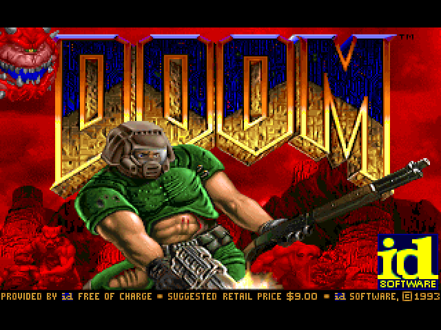

# doomacracy



Doom on a Terasic DE1, running on a homemade RV32IM CPU written in VHDL. See [spec.md](spec.md) for the memory map, registers and flash layout, and [sw/README.md](sw/README.md) for the software and the emulator.

The majority of this project was done with llms as a what if question on whether this was even possible.

## Build

```
nix develop path:$PWD
make sw emu            # firmware, flash image, emulator
make run-emu           # title screen in build/frames/
make cpu-test          # CPU against ideal memory
make soc-test          # whole board in nvc with chip models
make soc-boot          # boot the real firmware in nvc and compare with the emulator
make rom               # adds back boot rom
make qar               # build/doomacracy.qar Quartus archive
```

The WAD is not bundled with the repo; put the shareware `doom1.wad` in `wad/`.

## Running it on the board

`make qar` builds `build/doomacracy.qar`, which also carries `flash.bin` and
`jtag_flash.tcl`. In Quartus II 13.0 SP1:

1. Restore the archive, compile, and program `doomacracy.sof` (JTAG mode,
   one device in the chain).
2. Load the flash once, no Control Panel needed: put SW9 up, press KEY0 (HEX
   shows `1000`), then from the project folder run

   ```
   quartus_stp -t jtag_flash.tcl flash.bin
   ```

   HEX then counts through `2rr0` and `3rr0` (erasing and programming each
   64 KB region that changed) and `600d`, and the game boots. Only regions
   that differ from what's already in flash are rewritten, so loading a
   slightly changed image is quick.
3. Put SW9 back down. From now on KEY0 just boots Doom.

Redo step 2 only when the firmware changes. To try a Linux image without
writing the flash at all, put SW8 up as well as SW9: it boots straight from
RAM and is gone at the next reset.

the canonical repo for this is hosted on tangled over at [`https://tangled.org/dunkirk.sh/doomacracy`](https://tangled.org/dunkirk.sh/doomacracy)

<p align="center">
    
</p>

<p align="center">
    <i><code>&copy; 2026-present <a href="https://dunkirk.sh">Kieran Klukas</a></code></i>
</p>

<p align="center">
    <a href="https://tangled.org/dunkirk.sh/doomacracy/blob/main/LICENSE.md"></a>
</p>
